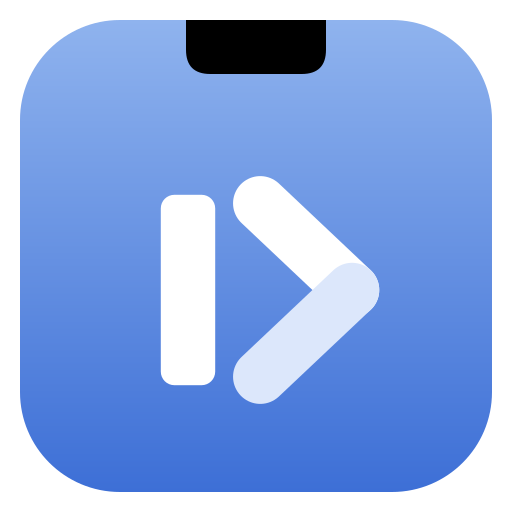

<p align="center">
  
</p>

# Hidden Bar and Notch (Raycast)

A local Raycast extension with two commands:

- **Toggle Hidden Bar**: expands or collapses the icons hidden by [Hidden Bar](https://github.com/dwarvesf/hidden).
- **Toggle Hidden Bar and Notch**: toggles Hidden Bar, then the notch in zNotch (`xyz.kondor.znotch://v1/manage?action=toggle`).

## Requirements

- Hidden Bar (`com.dwarvesv.minimalbar`) with a global shortcut set. Hidden Bar has no shortcut by default, and without one the commands show "No Hidden Bar shortcut set". To set it, right-click the Hidden Bar arrow in the menu bar, choose **Preferences...**, and on the **General** tab click the **Keyboard shortcut** field and press the keys you want (e.g. Ctrl+Opt+Cmd+B). The extension reads that shortcut every time it runs, so if you change it in Hidden Bar you don't have to change anything here.
- zNotch, only for the combined command.
- The **Accessibility** permission for Raycast: System Settings → Privacy & Security → Accessibility → turn on Raycast. Without it macOS blocks the shortcut, and the extension shows a toast with a button that opens these settings.
- Node.js and npm.

## Installation

```sh
make dev
```

`make dev` installs the npm dependencies and runs `ray develop`, which adds the extension to Raycast and keeps it updated while it runs. Once the commands show up in Raycast, you can stop it with Ctrl+C. The extension stays installed.

## How it works

Hidden Bar has no URL scheme or AppleScript support, so the commands press Hidden Bar's own shortcut:

1. Read `globalKey` from Hidden Bar's preferences and validate it (key code 0–127, boolean modifiers). The App Store build (1.8) keeps preferences in `~/Library/Containers/com.dwarvesv.minimalbar/…`, the direct build (1.13+) in `~/Library/Preferences/com.dwarvesv.minimalbar.plist`. The installed build's file is read first, then the other one.
2. If Hidden Bar isn't running, start it in the background (waits up to 2 s).
3. Send the shortcut with `osascript`: `tell application "System Events" to key code N using {…}`.

## Limitations

- Only toggle is supported. The extension doesn't know the state of Hidden Bar, so separate Show/Hide commands aren't possible.
- The combined command toggles each app independently. If their states get out of sync (e.g. icons expanded but notch hidden), fix it with **Toggle Hidden Bar** or the zNotch extension's Show/Hide commands.
- If another app uses the same shortcut, it will react to it too.

## Development

```sh
make test    # vitest: shortcut parser, AppleScript, error mapping, HUD message
make lint    # ray lint (ESLint + Prettier + manifest)
make build
```
